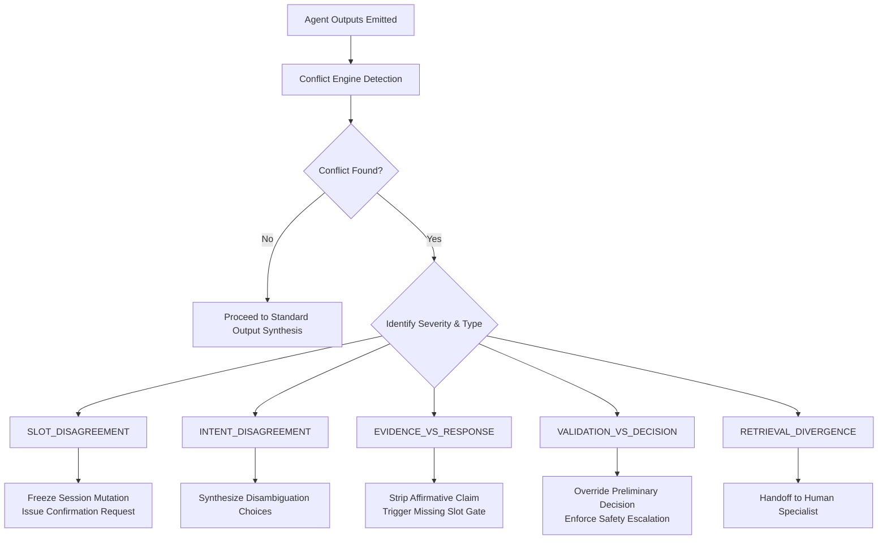

# RELAY AI — Agent Disagreement & Evidence-Based Conflict Resolution Engine

## 1. Overview and Core Philosophy

In multi-agent AI systems, different agents frequently produce contradictory, incompatible, or unsupported conclusions. Naive architectures attempt to resolve agent disagreements using majority voting or unvalidated LLM synthesis. In high-stakes customer support (order modifications, refunds, credential verification), majority voting is unacceptable: two miscalibrated or hallucinating agents must never outvote a grounded evidence source or a safety gate.

**RELAY AI's Principle of Evidence-Based Arbitration:**
> *Empirical training corpus evidence and deterministic validation checks strictly overrule ungrounded classifier guesses or generative assertions.*

---

## 2. The Five Detected Conflict Types

The `ConflictResolutionEngine` (`app/orchestration/conflict_engine.py`) continuously monitors intermediate agent outputs across six dimensions, identifying five primary conflict topologies:

| Conflict Type | Affected Agents | Trigger Condition | Severity | Deterministic Resolution Action |
|---|---|---|---|---|
| `INTENT_DISAGREEMENT` | `A1_IntentAnalyst` | Prediction margin < 0.15, confidence < 0.60, and competitor intent belongs to a different business category. | `MEDIUM` | `CLARIFICATION_REQUIRED` (synthesizes structured disambiguation prompt). |
| `RETRIEVAL_EVIDENCE_DISAGREEMENT` | `A1_IntentAnalyst`, `A2_ResponseSpecialist` | High classification confidence (≥ 85%), but corpus exemplar retrieval similarity < 0.35. | `HIGH` | `ESCALATION_RECOMMENDED` (flags unverified edge-case for human review). |
| `SLOT_DISAGREEMENT` | `SessionMemory`, `A2_ResponseSpecialist` | Current query parameter attempts to silently overwrite established session entity (e.g. order ID mutation). | `HIGH` | `CLARIFICATION_REQUIRED` (asks customer to confirm intended identifier). |
| `EVIDENCE_VS_RESPONSE_DISAGREEMENT` | `A2_ResponseSpecialist`, `ValidationAgent` | Response template asserts definitive completion verbs ("refunded", "cancelled", "dispatched") while required parameter placeholders remain unresolved. | `HIGH` | `CLARIFICATION_REQUIRED` (rejects affirmative verb, prompts for missing slot). |
| `VALIDATION_VS_DECISION_DISAGREEMENT` | `ValidationAgent`, `DecisionPolicyEngine` | Preliminary routing suggests automated execution (`PROCEED_AUTOMATED`), but safety validation gates fail. | `CRITICAL` | `ESCALATION_RECOMMENDED` (validation safety gates enforce absolute precedence). |

---

## 3. Deterministic Arbitration Rules

The engine arbitrates conflicts using deterministic state machines rather than stochastic LLM calls:

### Bounded Second-Pass Verification
When additional retrieval could resolve a borderline exemplar ambiguity, the system allows at most **one bounded retry (`max_retries = 1`)**. If the second retrieval pass does not exceed the similarity threshold, the conflict deterministically falls back to `ESCALATION_RECOMMENDED`.

---

## 4. Audit Trail & REST APIs

Every detected disagreement is captured as an `AgentDisagreementRecord` in `reports/agent_conflicts.json` and exposed via REST APIs:

- `GET /api/conflicts`: Paginated listing of recent disagreements with severity classification.
- `GET /api/conflicts/<id>`: Full inspector payload including side-by-side agent outputs, evidence references, and resolution explanations.

In the frontend workspace, the **Conflict Inspector Drawer** allows operators to drill into contradictory outputs, examine evidence references, and verify the deterministic resolution rationale.

