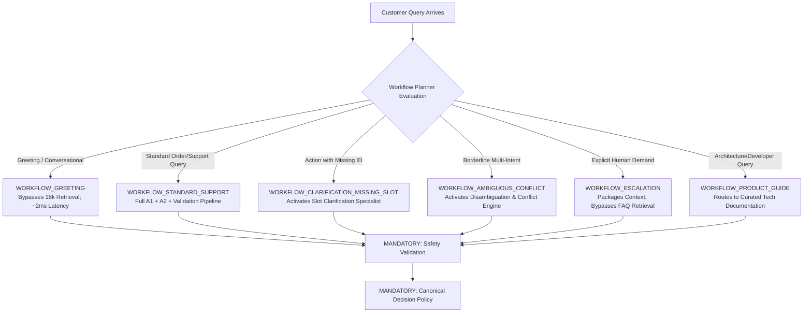

# RELAY AI — Dynamic Agent Team Formation & Capability Registry

## 1. Overview and Rationale

Static, one-size-fits-all pipelines force every inquiry through the same sequence of heavy ML operations. For a trivial customer greeting ("good morning"), invoking an 18,810-exemplar TF-IDF retriever and regex slot parser wastes compute and introduces unnecessary latency. Conversely, complex ambiguous inquiries require specialized disambiguation agents and arbitration engines.

**RELAY AI's Adaptive Team Formation** dynamically forms specialized agent teams tailored to the incoming query while maintaining an immutable safety guarantee:
> *Deterministic safety validation and canonical decision policy can NEVER be bypassed under any workflow.*

---

## 2. Central Capability Registry

The `CapabilityRegistry` (`app/orchestration/capability_registry.py`) catalogs 13 atomic capabilities with explicit inputs, outputs, prerequisites, and safety tiers:

| Capability ID | Title | Agent Role | Prerequisite | Mandatory? | Expected Latency |
|---|---|---|---|---|---|
| `intent_analysis` | A1 Intent Classification & Calibration | A1 Intent Analyst | None | Optional | ~2.5 ms |
| `domain_support_check` | Out-of-Domain Boundary Detection | Domain Specialist | `intent_analysis` | Optional | ~0.5 ms |
| `escalation_detector` | Explicit Human Escalation Check | Triage Analyst | None | Optional | ~0.4 ms |
| `session_memory_retrieval` | Session Memory & Context Recall | Session Specialist | None | Optional | ~0.3 ms |
| `product_guide_specialist` | Product Architecture & Tech Guide RAG | Guide Specialist | None | Optional | ~1.8 ms |
| `knowledge_base_retrieval` | A2 TF-IDF Exemplar Retrieval | A2 Response Specialist | `intent_analysis` | Optional | ~8.0 ms |
| `slot_resolution` | Slot Extraction & Template Filling | Slot Specialist | `knowledge_base_retrieval` | Optional | ~0.8 ms |
| `conflict_arbitration` | Evidence-Based Conflict Resolution | Conflict Engine | `intent_analysis` | Optional | ~1.0 ms |
| `disambiguation_specialist` | Ambiguous Intent Disambiguation | Clarification Specialist | `intent_analysis` | Optional | ~0.5 ms |
| `slot_clarification_specialist`| Missing Parameter Clarification | Slot Clarifier | `slot_resolution` | Optional | ~0.5 ms |
| `response_synthesis` | Response Grounding & Assembly | Synthesis Specialist | None | Optional | ~0.6 ms |
| `deterministic_safety_validation`| Validation Agent Safety Gates | Validation Agent | None | **MANDATORY** | ~1.2 ms |
| `canonical_decision_policy` | Canonical Decision Policy Engine | Decision Engine | `deterministic_safety_validation` | **MANDATORY** | ~0.4 ms |

---

## 3. The Six Dynamic Workflows

The `WorkflowPlanner` evaluates the query syntax, explicit keywords, session state, and user tone before selecting a plan:

### Explicit Rationale Tracking
Every skipped capability must carry a truthful, human-auditable rationale in the execution result:
- Example greeting skip rationale: `"Greeting input detected: skipping 18,810 exemplar TF-IDF retrieval to minimize latency without compromising safety."`
- Example escalation skip rationale: `"Explicit human escalation requested: bypassing automated FAQ search to package handoff context immediately."`

---

## 4. REST APIs & Frontend Visualization

- `GET /api/workflows/capabilities`: Exposes the capability catalog and mandatory invariant flags.
- `POST /api/workflows/plan`: Generates a preview plan with planned/skipped capabilities and reasons.
- In the React frontend, the **Adaptive Workflow Visualizer** displays active workflow badges, team formation timeline, and collapsible skipped capabilities with transparent explanations.

