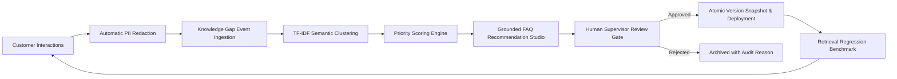

# RELAY AI — Self-Improving Knowledge Gap & FAQ Intelligence Engine

## 1. Overview and Continuous Improvement Lifecycle

Static customer support knowledge bases decay rapidly as customer terminology evolves and new product features emerge. Unaddressed friction queries—such as low-confidence predictions, failed exemplar matches, and repetitive human escalations—represent invaluable signals for knowledge base evolution.

**The RELAY Continuous Knowledge Loop:**

---

## 2. Privacy Redaction & Gap Ingestion

Customer queries frequently contain sensitive identifiers. Prior to recording any interaction to `reports/knowledge_gaps.json`, the `KnowledgeIntelligenceService` executes strict regex masking:
- Credit Card Numbers: `\b(?:\d{4}[ -]?){3}\d{4}\b` -> `[REDACTED_CC]`
- Email Addresses: `[A-Za-z0-9._%+-]+@[A-Za-z0-9.-]+\.[A-Za-z]{2,}` -> `[REDACTED_EMAIL]`
- Phone Numbers: US/International telephone patterns -> `[REDACTED_PHONE]`
- Social Security Numbers: `\b\d{3}[-]?\d{2}[-]?\d{4}\b` -> `[REDACTED_SSN]`

---

## 3. Query Clustering & Priority Scoring

Gap events are grouped into semantic clusters using tokenization and intent hypothesis grouping. To prevent operations teams from drowning in low-volume anomalies, clusters are ranked using a multi-factor priority formula:

$$\text{Priority Score} = \min\left(1.0, 0.4 \times \frac{\text{Volume}}{10} + 0.3 \times (1.0 - \overline{\text{Confidence}}) + 0.3 \times \text{Escalation Ratio}\right)$$

Where:
- $\text{Volume} / 10$: Normalized frequency component (capped at 10 occurrences).
- $(1.0 - \overline{\text{Confidence}})$: Model uncertainty deficit across the cluster.
- $\text{Escalation Ratio}$: Fraction of inquiries requiring human escalation.

Clusters scoring $\ge 0.70$ are highlighted as critical knowledge deficits.

---

## 4. Grounded FAQ Recommendation Studio

The system automatically drafts candidate FAQ Q&A entries for active clusters awaiting review.
**Strict Anti-Fabrication Guarantee:**
Recommendations are grounded exclusively in verified system categories and observed customer exemplars. The system never invents fake return windows, false warranty guarantees, or unauthorized fee waivers.

### Human-in-the-Loop Review Workflow
A proposed FAQ recommendation remains in `PENDING_REVIEW` until an authorized human supervisor approves or rejects it:
- **`APPROVE`**: Creates an immutable snapshot in `data/knowledge/versions/`, merges the article into `product_guide.json`, reloads the in-memory retriever, and marks status `DEPLOYED`.
- **`REJECT`**: Records supervisor ID and explicit rejection reason without modifying knowledge files.

---

## 5. Atomic Versioning, Rollback & Regression Benchmark

- **Immutable Version Snapshots**: Stored under `data/knowledge/versions/v_*.json` with metadata tracked in `versions_manifest.json`.
- **Atomic Rollback**: If an approved FAQ introduces unexpected behavior, the operator can restore any previous version snapshot with one click via `POST /api/knowledge/versions/<id>/rollback`.
- **Retrieval Regression Benchmark**: Runs 6 canonical regression tests across active documentation, enforcing that all benchmark queries meet similarity cutoffs and mean similarity $\ge 0.25$, validating `no_regression: true`.

