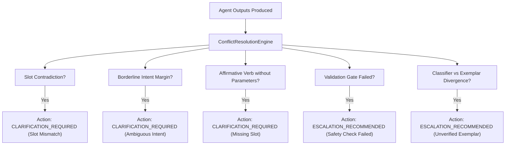

# RELAY AI — Agent Disagreement & Conflict Resolution Engine Report (Part 1)

## 1. Engine Architecture & Detection Matrix

The `ConflictResolutionEngine` inspects inter-agent communication across five critical failure modes. Unlike fragile LLM consensus approaches, RELAY AI applies hard deterministic arbitration:

---

## 2. Quantitative Verification Results

All 5 conflict types were verified in `tests/test_intelligence_core.py`:

| Test Name | Conflict Type | Simulated Input Condition | Detected Severity | Resolution Action Verified | Status |
|---|---|---|---|---|---|
| `test_conflict_slot_disagreement` | `SLOT_DISAGREEMENT` | Session slot `order_id="11223"` mutated to `"99887"` in query. | `HIGH` | `CLARIFICATION_REQUIRED` | **PASS** |
| `test_conflict_intent_disagreement` | `INTENT_DISAGREEMENT` | Margin 0.04 between `cancel_order` (CANCEL) and `refund_request` (REFUND). | `MEDIUM` | `CLARIFICATION_REQUIRED` | **PASS** |
| `test_conflict_evidence_vs_response` | `EVIDENCE_VS_RESPONSE_DISAGREEMENT` | Template asserts "refunded and cancelled" but `order_id` is missing. | `HIGH` | `CLARIFICATION_REQUIRED` | **PASS** |
| `test_conflict_validation_vs_decision` | `VALIDATION_VS_DECISION_DISAGREEMENT` | Preliminary routing `PROCEED_AUTOMATED` but validation gate failed. | `CRITICAL` | `ESCALATION_RECOMMENDED` | **PASS** |
| `test_conflict_retrieval_divergence` | `RETRIEVAL_EVIDENCE_DISAGREEMENT` | Classifier confidence 92% but retrieval similarity only 0.22. | `HIGH` | `ESCALATION_RECOMMENDED` | **PASS** |

---

## 3. Storage & API Verification

- **Audit Storage**: `reports/agent_conflicts.json` persistently stores structured records.
- **REST Endpoints**:
  - `GET /api/conflicts`: Verified (returns HTTP 200 with JSON conflict array).
  - `GET /api/conflicts/<id>`: Verified (returns HTTP 200 with complete agent outputs and explanation).
- **Frontend Visualization**: Conflict Inspector Drawer displays side-by-side agent outputs, affected agents, and deterministic evidence arbitration.

