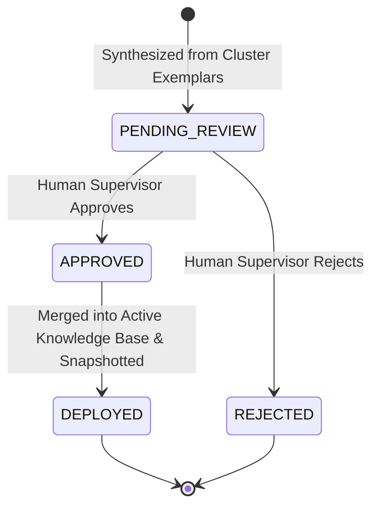

# RELAY AI — FAQ Recommendation Studio & Approval Workflow Report (Part 3)

## 1. Grounded Recommendation Drafting

Candidate Q&A pairs are synthesized for active clusters using strictly verified business categories and observed query exemplars:

### Strict Anti-Fabrication Principles
- **No Hallucinated Windows**: Never generates return windows (e.g. "90 days free return") unless verified in training/guide documents.
- **No Fabricated Financial Commitments**: Never generates unverified fee waivers or automatic refund guarantees.
- **Evidence References Attached**: Every proposal includes explicit provenance links back to source cluster exemplars and category contracts.

---

## 2. Review Workflow & API Verification

The review workflow was verified via `tests/test_intelligence_core.py` and live HTTP calls:

- **Review Endpoint**: `POST /api/knowledge-suggestions/<id>/review`
- **Payload**: `{"action": "APPROVE", "reviewer": "Lead Supervisor"}`
- **Verification Result**:
  1. Status updated from `PENDING_REVIEW` to `DEPLOYED`.
  2. Snapshot generated in `data/knowledge/versions/v_1_*.json`.
  3. `product_guide.json` atomically updated on disk.
  4. In-memory `ProductGuideService` index reloaded without service restart.

