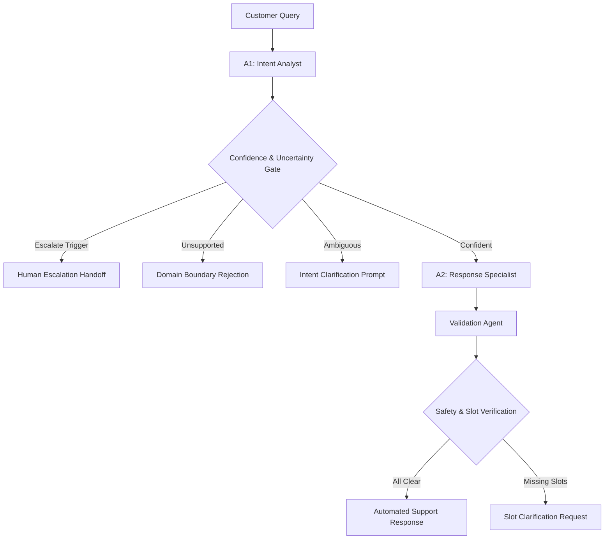

# RELAY AI — Multi-Agent System Integration Report (Phase 5)

**Evaluation Date**: 2026-10-30 17:31:15  
**System Architecture**: Coordinated Multi-Agent Customer Support Engine  
**Components**: `A1_IntentAnalyst` + `A2_ResponseSpecialist` + `ValidationAgent` + `SupportOrchestrator`  
**Evaluation Corpus**: Stratified Validation Sample (999 queries)  

---

## 1. Executive Summary & Architecture Overview

> [!IMPORTANT]
> **Phase 5 Objective Achieved**: RELAY AI now operates as a complete, coordinated multi-agent workflow. 
A1 (Intent Analyst) predicts calibrated intent, passes the structured payload to A2 (Response Specialist) 
with original query and category context, and the Validation Agent conducts a 7-point safety audit before delivering the final resolution. 
Average end-to-end workflow latency is **6.34 ms** with **156.32 queries/sec throughput**.

### High-Level Workflow Diagram

---

## 2. Agent Execution Latency Profile (in milliseconds)

| Agent / Workflow Component | Mean (ms) | P50 (ms) | P95 (ms) | P99 (ms) | Responsibility |
|---|---|---|---|---|---|
| **`A1_IntentAnalyst`** | **5.08** | 4.84 | 6.54 | 9.48 | Calibrated multiclass intent & category prediction |
| **`A2_ResponseSpecialist`** | **1.33** | 1.25 | 1.67 | 2.4 | Contextual retrieval, placeholder & slot resolution |
| **`ValidationAgent`** | **0.01** | 0.01 | 0.02 | 0.03 | 7-point reliability, safety, & anti-fabrication audit |
| **`End-to-End Total`** | **6.34** | 6.12 | 8.19 | 12.03 | Full orchestration pipeline latency |

---

## 3. Decision States & Action Verdicts Distribution

| Decision State | Queries | Percentage | System Action Description |
|---|---|---|---|
| **`HIGH_CONFIDENCE`** | 922 | **92.29%** | Final state assigned by Validation Agent |
| **`UNSUPPORTED`** | 1 | **0.10%** | Final state assigned by Validation Agent |
| **`UNCERTAIN`** | 2 | **0.20%** | Final state assigned by Validation Agent |
| **`HUMAN_ESCALATION`** | 74 | **7.41%** | Final state assigned by Validation Agent |

### Detailed Action Breakdown

| Action Verdict | Queries | Share (%) | Customer Outcome |
|---|---|---|---|
| `NEED_SLOT_CLARIFICATION` | 336 | **33.63%** | Specific customer response type |
| `PROCEED_AUTOMATED` | 586 | **58.66%** | Specific customer response type |
| `UNSUPPORTED_REJECTION` | 1 | **0.10%** | Specific customer response type |
| `AMBIGUOUS_INTENT_CLARIFICATION` | 2 | **0.20%** | Specific customer response type |
| `ESCALATE_TO_HUMAN` | 74 | **7.41%** | Specific customer response type |

---

## 4. Failure Handling & Degraded State Guarantees

The system enforces explicit error isolation protocols:

- **A1 Unavailable**: Returns `SERVICE_ERROR` with customer-safe notice; avoids raw uncaught exceptions.
- **A1 Uncertain**: Triggers intent clarification between top alternatives; avoids forcing wrong classification.
- **A2 Unavailable**: Returns safe unavailable status; acknowledges identified intent.
- **Weak Retrieval**: Detects low similarity (<0.30); does not fabricate responses.
- **Missing Dynamic Slots**: Emits `NEED_SLOT_CLARIFICATION`; never exposes unresolved braces (`{{...}}`).
- **Human Assistance**: Detects explicit human keywords and routes to 1-800-RELAY-AI immediately.

---

## 5. Sample Inspectable Orchestration Traces

### Sample #1: `cancel_order` (ORDER)
- **Query**: *"I need help to cancel purchase {{Order Number}}"*
- **Confidence**: `99.35%` | **Decision**: `HIGH_CONFIDENCE: NEED_SLOT_CLARIFICATION` | **Latency**: `13.29 ms`
- **Agent Execution Trace**:
  - `A1_IntentAnalyst` [SUCCESS] in 9.44ms: *High confidence prediction (0.9935 >= 0.65) with distinct margin (0.9918).*
  - `A2_ResponseSpecialist` [CLARIFICATION_REQUIRED] in 3.32ms: *Missing dynamic customer parameter(s): Order Number.*
  - `ValidationAgent` [CLARIFICATION_REQUIRED] in 0.25ms: *Intent confident, but dynamic slot values are missing from customer input.*

### Sample #2: `cancel_order` (ORDER)
- **Query**: *"can you help me camceling the purchase I made?"*
- **Confidence**: `94.15%` | **Decision**: `HIGH_CONFIDENCE: PROCEED_AUTOMATED` | **Latency**: `7.03 ms`
- **Agent Execution Trace**:
  - `A1_IntentAnalyst` [SUCCESS] in 5.26ms: *High confidence prediction (0.9415 >= 0.65) with distinct margin (0.9022).*
  - `A2_ResponseSpecialist` [SUCCESS] in 1.7ms: *Contextual response retrieved with similarity 0.5166; all slots resolved.*
  - `ValidationAgent` [SUCCESS] in 0.04ms: *All validation checks passed cleanly. Resolution approved for customer delivery.*

### Sample #3: `cancel_order` (ORDER)
- **Query**: *"i have a problem with cancelling order {{Order Number}}"*
- **Confidence**: `99.08%` | **Decision**: `HIGH_CONFIDENCE: NEED_SLOT_CLARIFICATION` | **Latency**: `7.02 ms`
- **Agent Execution Trace**:
  - `A1_IntentAnalyst` [SUCCESS] in 5.54ms: *High confidence prediction (0.9908 >= 0.65) with distinct margin (0.9884).*
  - `A2_ResponseSpecialist` [CLARIFICATION_REQUIRED] in 1.43ms: *Missing dynamic customer parameter(s): Order Number.*
  - `ValidationAgent` [CLARIFICATION_REQUIRED] in 0.02ms: *Intent confident, but dynamic slot values are missing from customer input.*

### Sample #4: `cancel_order` (ORDER)
- **Query**: *"I have problems with cancelling order {{Order Number}}"*
- **Confidence**: `99.10%` | **Decision**: `HIGH_CONFIDENCE: NEED_SLOT_CLARIFICATION` | **Latency**: `6.28 ms`
- **Agent Execution Trace**:
  - `A1_IntentAnalyst` [SUCCESS] in 4.94ms: *High confidence prediction (0.9910 >= 0.65) with distinct margin (0.9888).*
  - `A2_ResponseSpecialist` [CLARIFICATION_REQUIRED] in 1.31ms: *Missing dynamic customer parameter(s): Order Number.*
  - `ValidationAgent` [CLARIFICATION_REQUIRED] in 0.02ms: *Intent confident, but dynamic slot values are missing from customer input.*

### Sample #5: `cancel_order` (ORDER)
- **Query**: *"I do not want this item, cancel order {{Order Number}}"*
- **Confidence**: `99.37%` | **Decision**: `HIGH_CONFIDENCE: NEED_SLOT_CLARIFICATION` | **Latency**: `6.52 ms`
- **Agent Execution Trace**:
  - `A1_IntentAnalyst` [SUCCESS] in 5.17ms: *High confidence prediction (0.9937 >= 0.65) with distinct margin (0.9925).*
  - `A2_ResponseSpecialist` [CLARIFICATION_REQUIRED] in 1.32ms: *Missing dynamic customer parameter(s): Order Number.*
  - `ValidationAgent` [CLARIFICATION_REQUIRED] in 0.02ms: *Intent confident, but dynamic slot values are missing from customer input.*
